# 📻 radioCLI

**radioCLI — a webradio player for the terminal**, with an animated spectrum
visualizer: 64 frequency bands, oscilloscope, stereo VU meters, beat detection,
live track titles and an MP3 recorder.


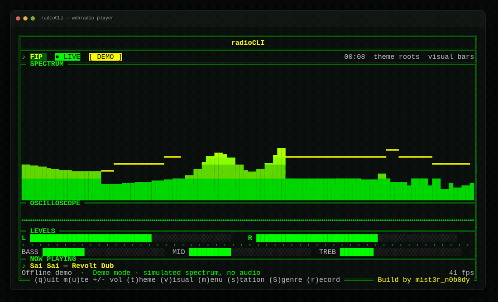

## Quick start (from GitHub)

```bash
git clone https://github.com/Mist3r-N0b0dy/radioCLI.git
cd radioCLI
./install.sh
radiocli
```

`./install.sh` creates a `~/.local/bin/radiocli` symlink to the clone; updates
are then just `git pull` (run `./install.sh` again if the clone moved).
No installation needed: run `./radiocli` from the repository directory.

> No `pip` required: `./install.sh` uses the clone's launcher directly. A
> regular Python install (`pipx`, `uv`, `pip`) is also available for an
> isolated global command.

### Twelve spectrum styles

| Bars | Vertical |
|---|---|
| 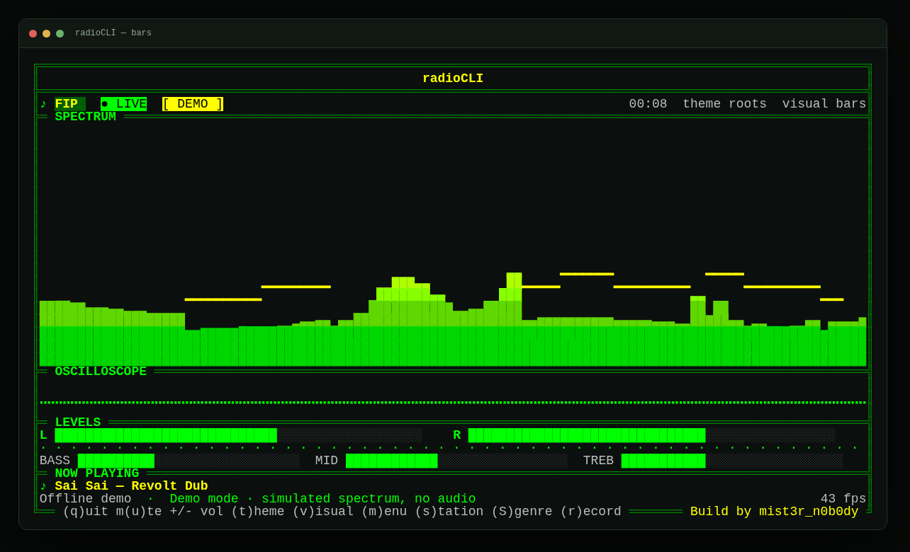 | 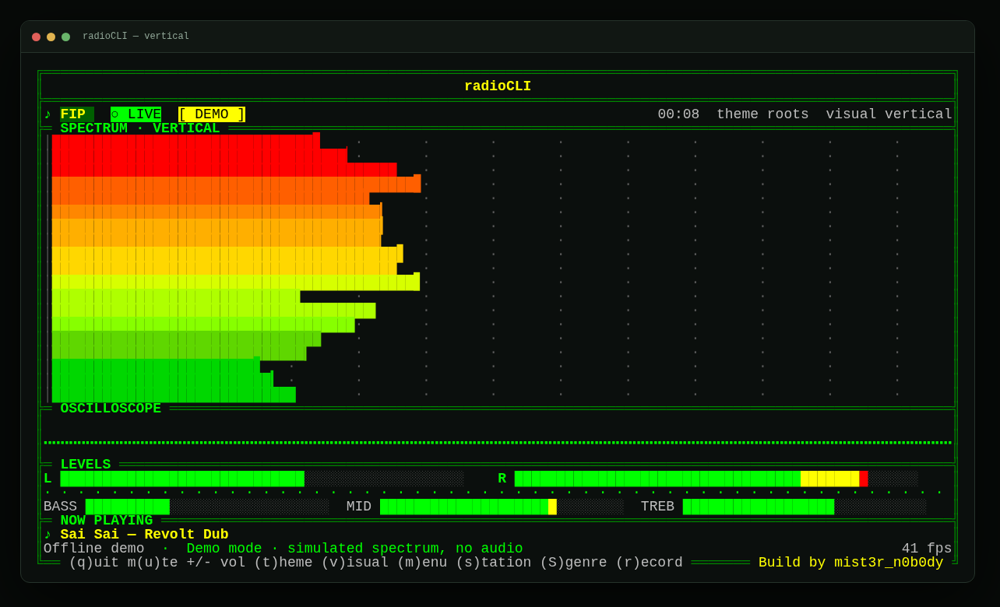 |

| Radial | Tunnel |
|---|---|
| 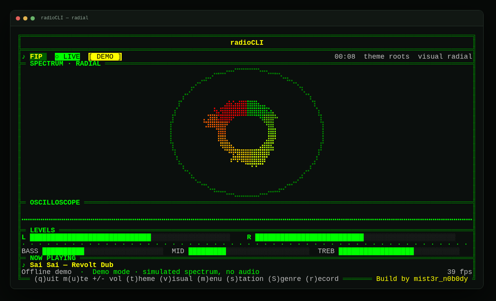 | 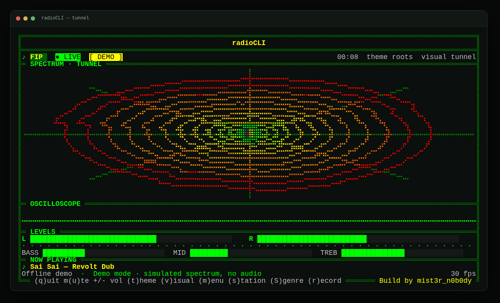 |

| Floating sphere | Flying carpet |
|---|---|
| 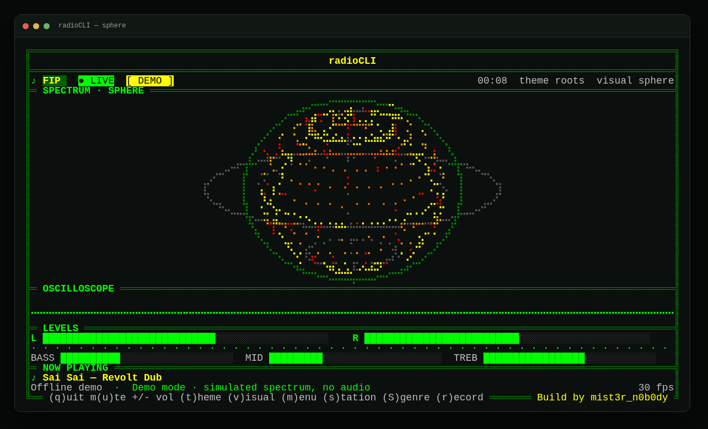 | 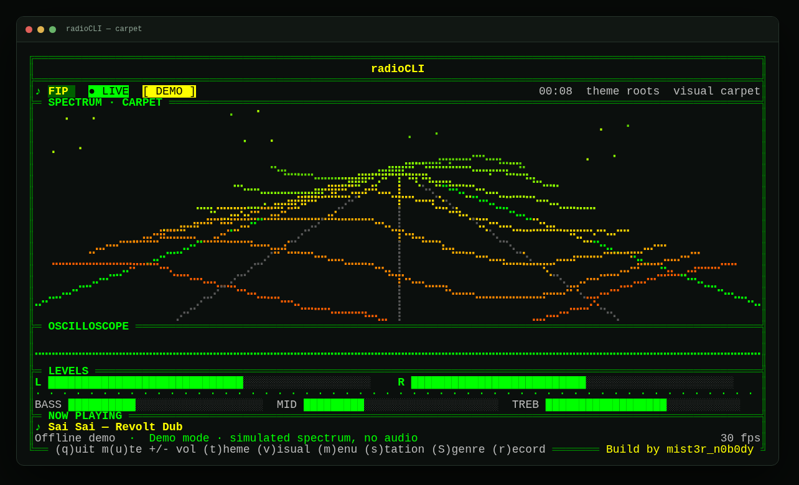 |

| Geodesic sphere | Reactive rosace |
|---|---|
| 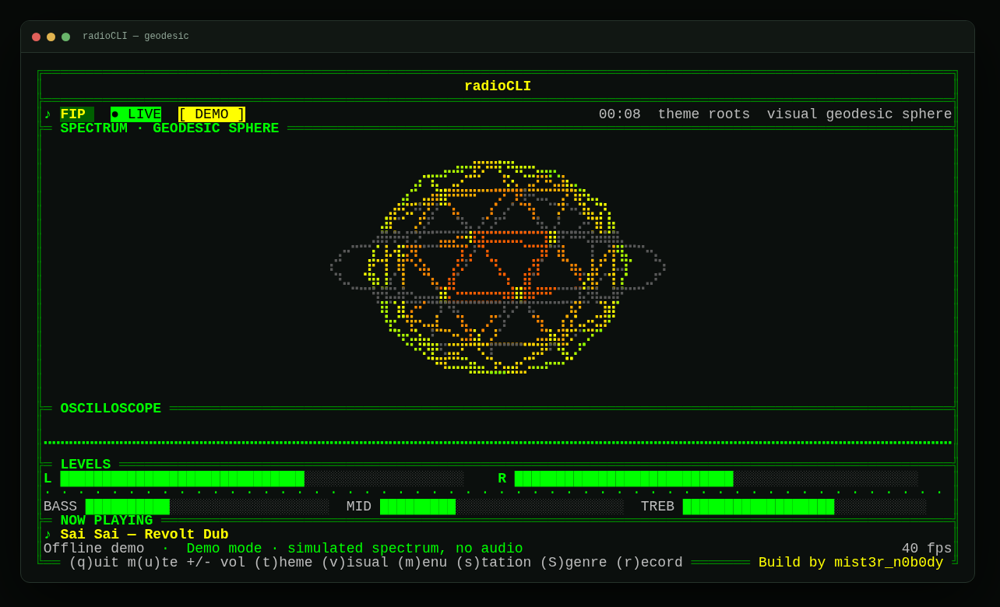 | 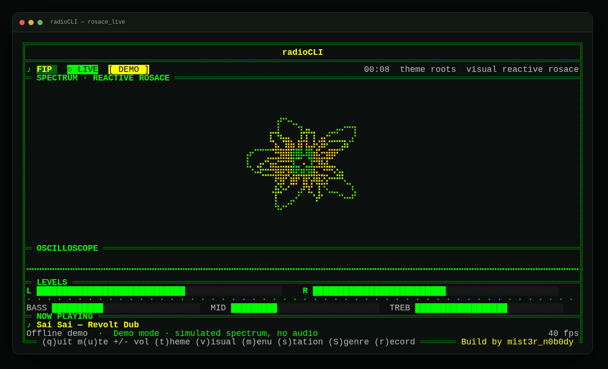 |

| Fractal mandala | Fractal rosace |
|---|---|
| 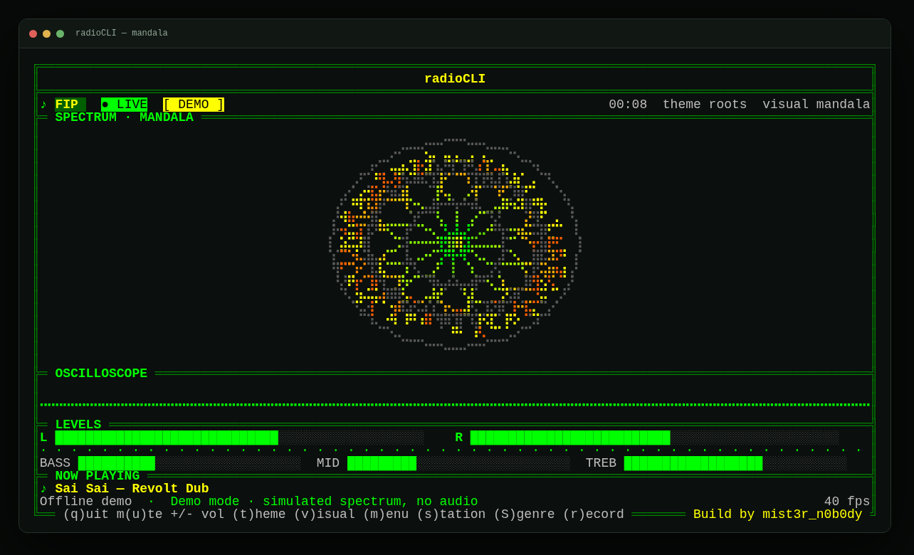 | 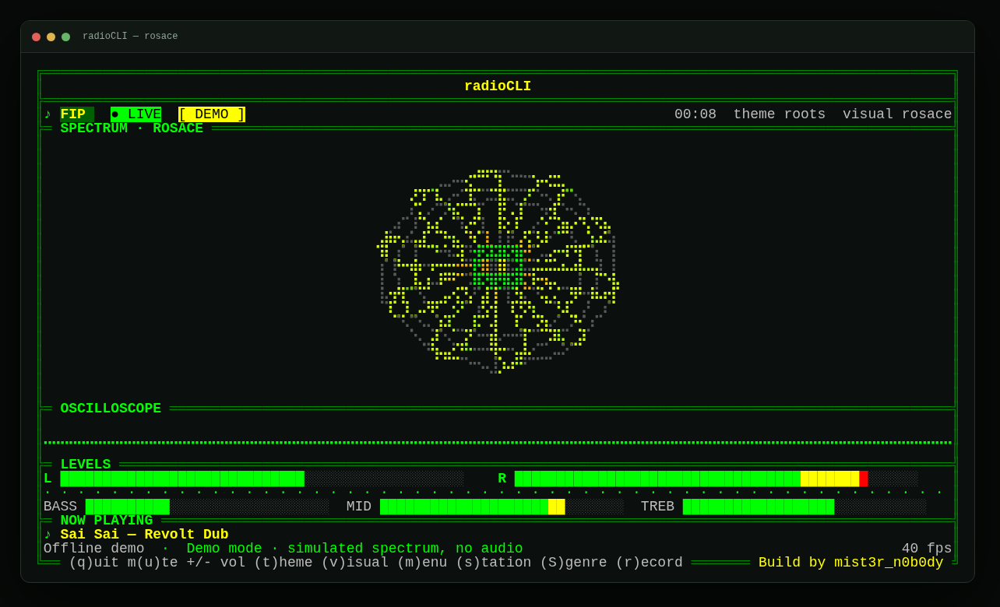 |

| Snowflake (flat fractal) | Spiral galaxy |
|---|---|
| 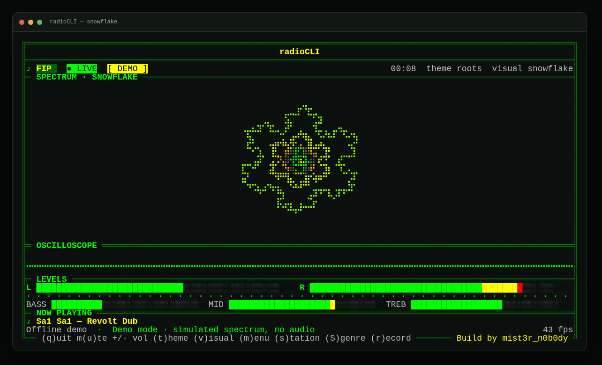 | 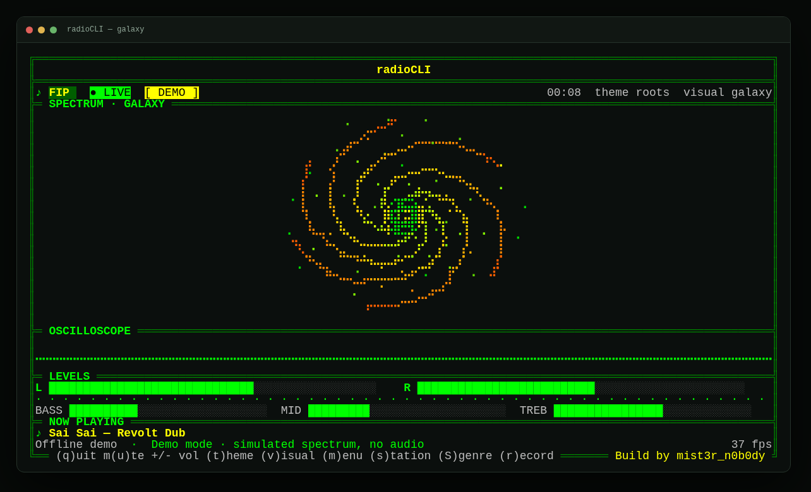 |

Change the style live with `v`, automatically with `a`, or at launch with
`--visual bars|vertical|radial|tunnel|sphere|carpet|geodesic|rosace_live|mandala|rosace|snowflake|galaxy`.

### Automatic mode & reactive colors

- **`a`** (or `--auto-visual`): pick a random visual every **10–30 seconds**;
  the ON/OFF state is shown in the menu.
- **`c`** (or `--reactive`): **music-driven palette** (hues drift with
  bass/mids/treble and the beat).

| Menu (auto + reactive ON) | Reactive colors |
|---|---|
| 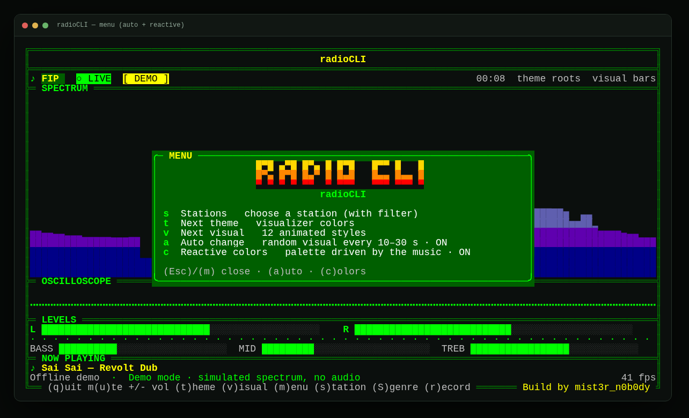 | 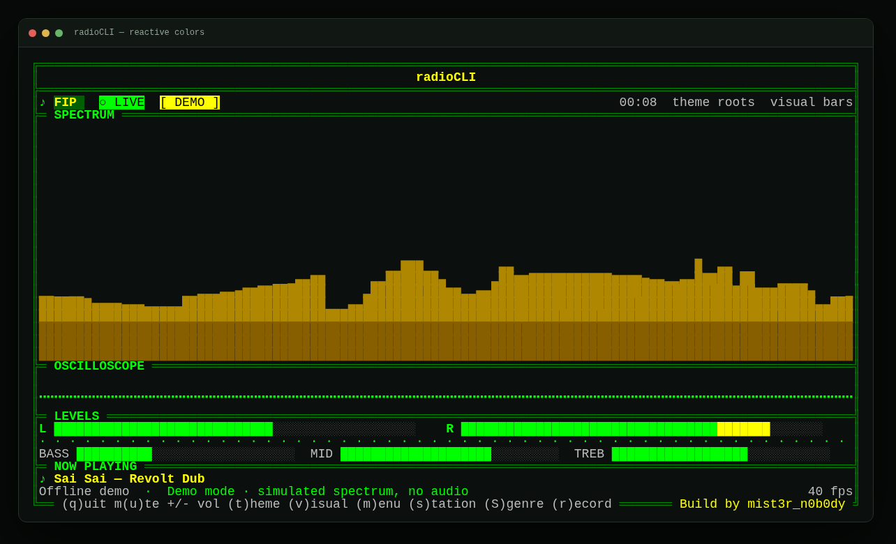 |

> radioCLI is a generic player: streams and their content belong to their
> respective radio stations.

---

## Features

- 🎵 **39 French webradios**: **public radio** (France Inter, France Info,
  France Musique, France Culture, ICI Chanson française, Mouv'), **FIP**
  (Rock, Metal, Jazz, Electro, Hip-Hop, World, Groove, Pop, Reggae), **French
  rap** (Mouv', Skyrock, Générations), **French variety** (M Radio, Chérie FM,
  RFM, Nostalgie), **electro / house / techno / drum & bass**, plus Radio Nova.
  La Grosse Radio streams are part of the catalog but are not the app's default.
- 📊 **Visualizer**: 64-band log spectrum, 256-color gradients, peak caps,
  oscilloscope, L/R VU meters, bass/mid/treble meters and beat pulse.
- 🎨 **12 spectrum styles**: **bars** (default), **vertical**, **radial**,
  **tunnel**, **floating sphere**, **flying carpet**, **geodesic sphere**,
  **reactive rosace**, **fractal mandala**, **fractal rosace**, **Koch
  snowflake** (a whole flat fractal that pulses with the music) and **spiral
  galaxy** (press `v` to cycle).
- 🔀 **Automatic visual switching**: press `a` (or `--auto-visual`) for a new
  random visual every **10–30 s**.
- 🌈 **Reactive colors**: press `c` (or `--reactive`) to make the spectrum
  palette follow bass/mids/treble and the beat. Only the spectrum area is
  recolored; the rest of the UI stays stable.
- 🪧 **Branding**: a `radioCLI` title inside a double-line frame at the top and
  an ASCII-art logo in the main menu.
- ✍️ **Build by mist3r_n0b0dy** signature at the bottom of the screen.
- 🗂️ **Menu (`m`)**: a **filterable** station picker grouped by genre — type to
  filter, Enter to play, Esc to go back; theme/visual shortcuts are available
  in the same menu.
- 🏷️ **Live title**: ICY (`StreamTitle`) metadata with a scrolling marquee when
  the station provides one (Radio France does not expose ICY titles).
- 🎛️ **Keyboard controls**: mute, volume, themes, station switching and MP3
  recording.
- 🔁 **Resilient**: automatic stream reconnection and player restart when the
  network or mpv drops; a `RECONNECTING…` overlay is shown while recovering.
- 🪶 **No Python dependencies**: standard library only. The FFT is implemented
  by hand.
- 💾 **Recording**: press `r` to save the stream as-is (MP3 copy) under
  `~/Musique/radioCLI/` (override with `RADIOCLI_RECORD_DIR`).
- 🧪 **Useful modes**: `--demo` (offline simulated visualizer), `--no-audio`
  (analysis without sound) and `--stats` (headless diagnostics).

## Requirements

| Tool | Role | Required |
|---|---|---|
| Python ≥ 3.10 | runtime | yes |
| [ffmpeg](https://ffmpeg.org/) | stream decoding for analysis + recording | yes |
| [mpv](https://mpv.io/) (or `ffplay`) | audio playback | recommended |
| UTF-8 terminal (80×24 recommended) | Unicode block rendering | yes |

On Arch / Omarchy:

```bash
sudo pacman -S python ffmpeg mpv
```

## Installation

### From a clone (recommended)

```bash
git clone https://github.com/Mist3r-N0b0dy/radioCLI.git
cd radioCLI
./install.sh          # checks python/ffmpeg/mpv and installs "radiocli"
radiocli
```

The script copies nothing: it creates a symlink to the clone's launcher.
To uninstall: `./install.sh --uninstall`.

### Without installing

```bash
git clone https://github.com/Mist3r-N0b0dy/radioCLI.git
cd radioCLI
./radiocli            # run directly, no global command
```

### With pipx / uv / pip

```bash
pipx install .        # isolated global command
# or
uv tool install .
# or
python3 -m pip install --user .
```

No Python dependency is downloaded: radioCLI only uses the standard library
(curses, a home-made FFT, etc.).

### Updating

```bash
cd radioCLI
git pull
./install.sh
```

## Usage

```bash
radiocli                          # FIP, audio + visualizer
radiocli --demo                   # simulated visualizer, no network
radiocli --station mouv           # French rap (France Inter, fipjazz, ...)
radiocli --list-stations          # list the 39 webradios, grouped
radiocli --url http://.../stream.mp3  # custom Icecast stream
radiocli --visual radial          # spectrum style (bars by default)
radiocli --auto-visual            # random visual every 10–30 s
radiocli --reactive               # music-driven palette
radiocli --fps 60                 # even smoother rendering
radiocli --theme dub              # color theme
radiocli --no-audio               # analyze the stream without playing sound
radiocli --stats --duration 10    # headless test (debug)
```

### Keyboard shortcuts (UI in English)

The interface (headers, hints, menu, statuses) is fully in English.
Shortcuts are shown as the letter in parentheses, e.g. `(q)uit`.

| Keys | Action |
|---|---|
| `(q)uit` / `Esc` | quit |
| `m(u)te` / `Space` | toggle mute |
| `+` / `-` (`k` / `j`) | volume ±5 % |
| `(m)enu` | open/close the menu |
| `(t)heme` | next theme (`roots`, `sunset`, `dub`, `menthe`, `mono`) |
| `(v)isual` | next visual (12 styles) |
| `(a)uto` | toggle automatic visual change (10–30 s) |
| `(c)olors` | toggle music-reactive colors |
| `(s)tation` | next station in the same genre |
| `(S)genre` | next genre (first station) |
| `(r)ecord` | start/stop MP3 recording |

### Menu (`m`)

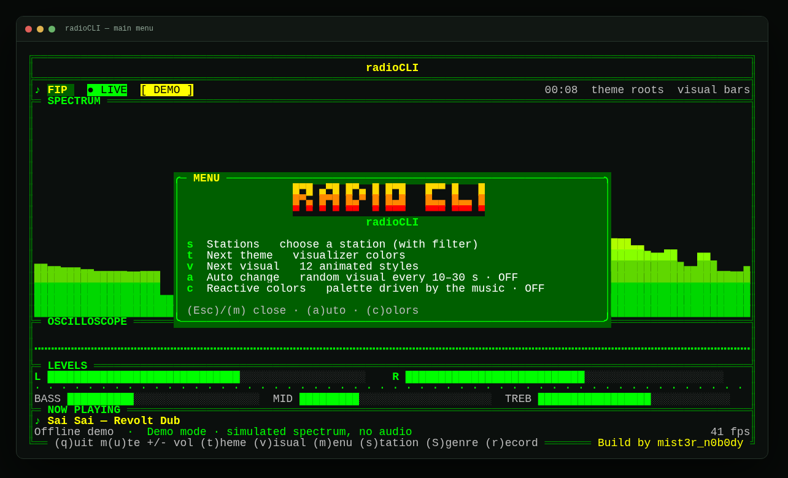

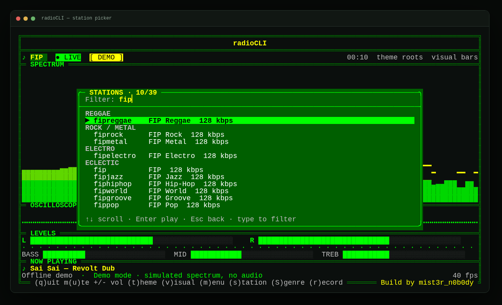

`m` opens a modal menu with the **radioCLI** ASCII logo at the top:

- **`(s)`** → **Stations**: list grouped by genre, **keyboard filter**
  (type `rap`, `fip`, `france`, `variety`, ...), `↑`/`↓` (or PgUp/PgDn,
  Home/End) to scroll, **Enter** to play, **Esc** to go back;
- **`(t)`** → next theme, **`(v)`** → next visual;
- **`(a)`** → auto visual change (10–30 s), **`(c)`** → reactive colors;
  the ON/OFF state is shown in the menu;
- **Esc** or **`(m)`** → close.

While typing a filter, letters (including `s`, `q`, `m`) go to the filter:
use **Esc** to leave the submenu. The menu is drawn over the visualizer and
audio keeps playing.

### Stations (39, grouped by genre)

`s` moves to the next station in the **same genre**; `S` moves to the **next
genre**. All URLs are checked and played as MP3 (ffmpeg/mpv).

**Reggae** — `reggae` La Grosse Radio Reggae 192 · `reggae-64` La Grosse Radio
Reggae 64 · `fipreggae` FIP Reggae 128

**Rock / Metal** — `rock` La Grosse Radio Rock 192 · `metal` La Grosse
Radio Metal 192 · `fiprock` FIP Rock 128 · `fipmetal` FIP Metal 128

**French rap** — `mouv` Mouv' (Radio France) 128 · `skyrock` Skyrock 128 ·
`generations` Générations 128

**French variety** — `mradio` M Radio 128 · `cheriefm` Chérie FM 128 ·
`rfm` RFM 128 · `nostalgie` Nostalgie 128 · `icichanson` ICI 100% Chanson
française 128

**Public radio** — `franceinter` 128 · `franceinfo` 128 ·
`francemusique` 128 · `franceculture` 128

**Electro** — `fipelectro` FIP Electro 128 · `radiofg` Radio FG 128 ·
`meuh` Radio Meuh 128

**House / Vocal** — `fgdeep` FG Deep Dance 128 · `fgchic` FG Chic 128 ·
`tldeep` Technolovers Deep House 192 · `pulsclub` PulsRadio Club 192

**Techno / Minimal** — `fgunderground` FG Underground 128 ·
`fgtechno` FG Techno 128 · `tlminimal` Technolovers Minimal 192

**Drum & Bass** — `bassdrive` Bassdrive 128 · `dnbradio` DNBRadio 128 ·
`edmdnb` DnB&EDM 128

**Eclectic / all styles** — `fip` 128 · `fipjazz` 128 · `fipelectro` 128 ·
`fiphiphop` 128 · `fipworld` 128 · `fipgroove` 128 · `fippop` 128 ·
`nova` Radio Nova 128

`radiocli --list-stations` prints the full list with URLs.

> **FIP** (originally *France Inter Paris*) is Radio France's eclectic music
> station; “FIP Jazz/Rock/Electro...” are its themed webradios.

## How it works

```text
                ┌──────────────────────────────────────────────┐
  Icecast ──────┤ mpv  ─────────────────────────────► 🔊 audio  │
                │ ffmpeg (PCM 44.1 kHz stereo) ───► analyzer   │
                │ ICY (raw socket) ───────────────► title      │
                └──────────────────────────────────────────────┘
                                   │
                        FFT 1024 + log bands + VU + beat
                                   │
                          curses loop 40 fps (render.py)
```

- **Playback**: `mpv` plays the stream (volume/mute driven by its JSON IPC
  socket); `ffplay` is used as a fallback.
- **Analysis**: a second `ffmpeg` decodes the same stream to raw PCM. A pure
  Python radix-2 FFT (1024 points), Hann window, 64 log bands from 32 Hz to
  16.5 kHz, automatic sliding-roof normalization, attack/release smoothing,
  peak-hold and bass beat detection.
- **Title**: a separate `Icy-MetaData: 1` HTTP connection reads `StreamTitle`
  blocks without replaying audio.
- **Supervisors**: the capture thread and player are restarted with
  exponential backoff after a failure; the renderer reports reconnection.
- **UI**: full repaint every frame; terminal resizing is handled, with 256-color
  gradients falling back to 8 colors / monochrome.
- **Visuals**: bar and vertical modes use Unicode blocks; radial and tunnel
  modes use braille (2×4 dots per cell) for smooth curves; every mode
  recomputes its geometry on each frame.

## Recordings

Press `r` to record the stream as-is (MP3 copy, 192 kbps) to
`~/Musique/radioCLI/radiocli-<station>-<date>.mp3`.
The directory can be changed with `RADIOCLI_RECORD_DIR`.

## Development

```bash
PYTHONPATH=src python3 -m unittest discover -s tests -v
python3 tools/render_demo.py --seconds 5 --visual radial
python3 tools/screenshot.py --help
```

## Tests

```bash
PYTHONPATH=src python3 -m unittest discover -s tests -v
```

Pure unit tests (FFT analyzer, bands, VU, ICY, demo, CLI) and layout/render
helper tests. No network is required.

## Troubleshooting

| Symptom | Hint |
|---|---|
| No sound | check `mpv`/`ffplay` and `pactl info`; the mute key is `Space`, not `m` |
| “Reconnecting to stream…” | test `curl -I https://icecast.radiofrance.fr/fip-midfi.mp3`; network/proxy may be blocked |
| Empty title | the server does not send ICY metadata or the title has not scrolled yet |
| Squares/question marks | non-UTF-8 terminal (`locale`); change font or terminal |
| Terminal too small | 40×12 remains readable; below that compact mode applies |
| Visualizer frozen but audio works | `ffmpeg` missing or blocked; run `--stats` to diagnose |

## License

MIT — see [LICENSE](LICENSE). The audio streams and their metadata are not
covered by this license.
